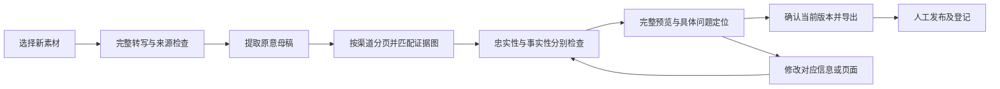

# PRD｜图文攻略原意保留 v1.0

## 1. 文档信息与决策

- 日期：2026-11-04；状态：需求基线已编制，可进入迭代 0；开发、上线及内容验收均未完成。
- 业务依据：[完整方案](图文攻略原意保留与流程精简方案-2026-11-04.md)；用户确认按此准备迭代，旧稿不返修。
- 配套：[迭代计划](迭代计划-图文攻略原意保留-2026-11-04.md)、[开发任务单](任务单-图文攻略原意保留-2026-11-04.md)。本 PRD 管需求，任务单管实施状态。
- 渠道：头条图文攻略、公众号图片消息；共享内容母稿、独立渠道验收。公众号完整文章保持独立入口。
- 基线：本地 `main@83d7d4a` 加当前未提交工作树。该提交单独不代表已检查的功能版本；迭代 0 必须保存所涉文件基线。
- 本轮产出 Markdown 文档；不另建交互原型、不改代码、不调用收费生成。开发基于现有弹窗做增量交互。
- 交付策略：首批只实施 T00–T06，预计 3–4 个有效开发工作日；本 PRD 其余需求保留为完整路线，首批验收不能宣称全量 PRD 完成。首批实测后再确定后续优先级。

## 2. 背景、问题与目标

已成型视频的核心信息经过重复扩写、重新立论、固定分页、字段裁剪和自动补图，可能失去原来的主体、条件与重点。用户需要的是便于阅读和保存的图文，不是每次重新创作一篇观点文章。

目标优先级：原意与条件完整 > 核心突出 > 手机可读 > 视觉变化。忠实转述与事实正确分别判断；原作者说过不能自动升级为已核事实。

### 2.1 本期验收指标

| 指标 | 口径与目标 | 验证责任 |
| --- | --- | --- |
| 必保点覆盖 | 编辑对完整原片独立确认必保点后，成品准确承载数/必保点数＝100%；分母不能仅由生成模型自评 | 内容验收人 |
| 语义漂移 | 主体、对象、数值、条件、顺序、确定程度发生错误改变＝0 处 | 开发反例检查＋内容验收 |
| 无来源新增结论 | 标题、图上字、配文全部扫描＝0 处 | 内容验收 |
| 排版导致信息丢失 | 所有输出页无截句、丢卡、丢尾页；不能以草稿里有字代替图片里有字 | 自动比对＋逐图检查 |
| 图文相关 | 每张证据图确实展示对应对象或动作；不相关证据图＝0 张 | 逐图检查 |
| 首屏重点 | 测试读者阅读首屏后能复述核心答案及必要条件；每样本记录复述与判定理由 | 号主或目标读者 |
| 成本与效率 | 记录两阶段及核验实际调用次数、耗时、费用、人工修改；换皮肤语义生成调用＝0 次 | 开发日志 |

首次验收取后续 3 条新素材：操作、改动、观点/比较各一条；每条生成头条和公众号包，共 6 包。它们用于验证流程，不据此承诺阅读、涨粉或收益。

## 3. 项目现状与复用边界

| 现有能力/问题 | 代码或接口证据 | 本期处理 |
| --- | --- | --- |
| 素材、转写、整理稿已入 SQLite；有 structured_data、source_video_ids | `src/content_store.py:save_summary/material_source_text` | 复用，母稿逻辑数据契约扩展，存储方案在迭代 0 定稿 |
| 已有生成入口及排产生成 | `/api/content/generate`、`/api/plan/task/generate` | 新模式必须覆盖两入口；既有 summary_type 白名单不能只改模型提示词 |
| 海报拆解、逐页编辑、预览、恢复、审核已有实现 | `/api/poster/plan`、`/plan/page`、`/preview`、`/generate`、`/review` | 增量接入，保留失败恢复与已有人工编辑 |
| 固定递进、部件、卡数；字段和末位内容被裁剪 | `src/ai_poster.py:_PLAN_PROMPT/_GUIDE_RULES/fit_plan/_normalise_page/guide_clip` | 全链路消除内容迁就版式的规则 |
| 排版仍有独立裁剪点 | `src/poster_typeset.py` 标题行数、尾注、警示块、卡片绘制；`src/graphics/ir.py` 与模板待逐项审计 | 不能只修改 fit_plan；最终图片也必须无损 |
| 帧池已有时间戳与画面判定；兜底补图不按语义匹配 | `src/frame_pool.py`、`src/ai_poster.py:bind_frames` | 按内容和时间段找图，不重建帧池 |
| 公众号图片消息已共享头条渲染循环，但仍独立生成卡片 | `src/graphics/channels/wechat.py` | 复用内核，改为消费母稿；取消固定 6–8 页，不重做渠道合并 |
| 源文本存在 5000/8000/12000 字截取；海报 PAGE_MAX=6，公众号超过 MAX_IMAGES 会截卡 | 现有输入/分页代码 | 不把代码上限当平台事实；达到上限必须明确失败或拆组，不能静默截掉 |
| 已有事实、行动、机制、版本审核和编辑证据链 | `fact_gate/claim_check/action_gate/guide_provenance/review_store` | 扩展现有体系；未判不视为通过，不再建第二套游戏事实库 |
| 工作树大量并发修改 | `git status`，涉及核心文件、UI、测试 | 先固化任务基线与文件归属，禁止从裸 HEAD 开发后覆盖工作区新功能 |

## 4. 用户、范围与流程

用户为号主/编辑；开发负责工具正确性，内容验收人负责关键事实和实际阅读。自动化不执行平台发布。

本期包含：单视频默认原意提取、必要补充资料引用、两渠道分页、核心信息映射、关联截图、集中预览、失败恢复、版本校验失效、旧包兼容。

不包含：旧稿返修或批量重生成、扩采集源、增加运营排期、自动发布、改赛道与经营策略、默认多素材专题、AI 生成游戏证据画面、通用写作平台重构。已有合集入口保留，未支持新契约时明确标旧模式，不假装完成新版校验。

主操作保持「生成图文 → 看完整预览 → 确认导出」。后台分两个逻辑加工阶段，不要求用户先填母稿表。长素材分段及核验可能多次调用，不能宣传为永远只有两次 API 调用。

## 5. 功能需求

| 编号 | 需求与业务规则 | 验收/异常处理 |
| --- | --- | --- |
| FR-01 | 新图文默认“保留原意”；原始素材为根，不能把旧整理稿当原视频事实源；公众号文章、面试题与旧合集保持原模式 | 直接生成和排产入口结果一致；只有旧整理稿无原文时可看旧稿，新模式提示补原文，不伪造来源 |
| FR-02 | 完整处理源文本，长文按完整语句/时间段分段，处理状态可追溯；缺时间戳可用段落定位 | 尾段关键点仍进入母稿；任何段失败显示具体段并阻止宣称“完整处理”；未配置 AI 时采集照常、生成停留草稿 |
| FR-03 | 母稿包含核心问题/答案、类型、必保/支撑/可省略信息、主体与条件、原句、源定位、证据状态 | 原句不存在或定位不匹配不能算来源已关联；保留原题范围，不被排产标题强迫扩写；缺关键事实进入待核 |
| FR-04 | 原文口语只去重复/赘词；不增加必须的步骤、机制、避坑或个人观点；标题不能比证据更绝对 | 五类内容选择对应结构；观点明确归属；“可能”不能变“必然”；自称亲测/已核必须有相应记录 |
| FR-05 | 页面绑定母稿信息，第一屏呈现核心答案和影响理解的条件；部件、页数、卡数按内容决定 | 允许单页、重复步骤版式、无互动页；超过技术容量不得截掉余页。用户限页不足返回具体未容纳信息及拆分建议 |
| FR-06 | 保留原文/母稿/页文案全量文本；先换行、拆页、换内容布局，不能删卡、截句、无限缩字 | 字段超长和最终像素溢出均可定位；无法排下可保存预览草稿，不能输出为可发布成品 |
| FR-07 | 证据图按该页动作/对象及源时间段匹配；连续操作允许相近时刻不同状态；自动补图必须有匹配依据 | 无关高清图不得补入；可纯文字表达的内容允许文字页；关键操作图缺失需补帧/上传并重新检查；图注错误不算匹配成功 |
| FR-08 | 忠实性检查覆盖必保遗漏、主体、条件、概率与顺序；标题、图上字、配文都检查；核验事实与忠实性分列 | ID 覆盖与语义检查结果分开；确定性差错阻止就绪，模型疑点定位给人；未知/核验失败不显示全已核 |
| FR-09 | 一份母稿可派生两渠道，分别保存标题、配文、页面、图片、检查与发布状态 | 头条默认 9:16、公众号默认 3:4；比例变化不改核心结论；一端签审不替另一端签审 |
| FR-10 | 预览顶部显示核心答案、必保点位置、待处理问题；点问题联动原句/时间段/对应页 | 无视频文件时提供文本定位且说明无法播放；内部字段和审校话不漏到图上；用户无需逐句手工贴来源 |
| FR-11 | 换皮肤只渲染；比例/字号变化只重新排版和相关检查；内容变化才重新检查受影响内容 | 单页修复保留其他页人工修改；无须 LLM 的操作真实调用数为 0；不隐式整篇重写 |
| FR-12 | 源文本、母稿、成品及核验具有版本关系；修改后旧审核失效；导出核对当前版本 | 较早请求后完成不能覆盖较新编辑；母稿更新后两渠道均显示待更新，不覆盖已发快照；编辑内容后不能沿用旧 PASS |
| FR-13 | 失败保留最后有效内容；可定位失败阶段、重试该阶段；扣费可能发生时如实显示未知状态 | 超时不自动全篇重生，不自动重复收费重试；重开弹窗可恢复；未配置模型不出伪成功兜底成品 |
| FR-14 | 老包可读，缺新版字段显示“旧版，未做新版校验”；新模式增量试用、可关闭 | 不迁移/覆盖旧稿；关闭新模式仍能读取新草稿及导出历史既有包，新草稿不得静默退回旧生成器 |
| FR-15 | 记录实际调用、处理段、页数、耗时、token/费用可得性、人工改动与模型/规则版本 | 不用估值填实际成本；未知值明确标未知；不把质量过程指标当涨粉收益；运行数据不入 git |

## 6. 数据、状态与交互契约

### 6.1 业务数据项（逻辑要求，不规定 DDL）

| 字段 | 类型 | 约束 |
| --- | --- | --- |
| schema_version / generation_mode | 字符串 | 新旧模式可辨，缺省为旧版，不强行解释成新版 |
| source_refs | 对象数组 | 源 ID、标题、作者、日期、定位；发布日/核验日/生成日区分；缺失不编 |
| source_revision / mother_revision | 字符串 | 源、母稿版本，可检出变化；母稿不可被下游修改反写 |
| main_question / core_answer | 字符串 | 核心问题和答案，非空；答案必要条件不得脱离 |
| content_type | 枚举字符串 | operation/change/comparison/opinion/list，对应操作/改动/比较/观点/清单 |
| source_spans | 对象数组 | 段 ID、字符范围、可空时间段、处理状态；全文无未说明空洞 |
| points | 对象数组 | 稳定 point_id、quote、display_text、priority、主体/条件、source_ref、证据状态；必保不能为空集合以规避检查 |
| omitted | 对象数组 | 被省略片段及理由；不能把关键疑点归作赘述 |
| point_ids | 字符串数组 | 每条实质性页面/标题/配文的来源映射；纯导航与来源脚注标角色豁免，不虚构 ID |
| asset_refs | 对象数组 | 画面、来源、时间段、用途、对应 point_ids、匹配/人工确认结果 |
| checks | 对象 | 事实/忠实性/版面独立状态、具体问题、覆盖范围、输入版本、执行方法 |
| package_revision / reviewed_revision | 字符串或空 | 当前包版本与签审版本一致才可就绪 |
| channel / usage | 枚举字符串 / 对象 | 渠道隔离；实际调用与成本未知值为 null，不用 0 冒充 |

### 6.2 页面状态与操作

| 页面状态（中文） | 可做 | 不允许 |
| --- | --- | --- |
| 处理中 | 查看阶段/已处理段，保留已存草稿 | 显示伪百分比或提前标完成 |
| 草稿 | 编辑、预览、补来源 | 无核验直接标可发布 |
| 待处理 | 点问题看原文/页面，定点修复 | 自动删问题句掩盖缺口、批量无依据放行 |
| 待确认 | 查看全包，确认当前版本 | 复用旧版本签审 |
| 可导出 | 导出该版本完整包 | 服务器只信前端“已核”标志 |
| 已更新，需复核 | 看差异、重验 | 覆盖发布快照或宣称线上已更正 |
| 失败可恢复 | 恢复已保存稿、重试具体失败阶段 | 无提示改写全部内容或自动重复付费 |

预览允许带问题的草稿，但不能伪装成已通过包。事实硬错误、必保缺失、句子截断、关键证据缺口、版本过期阻止就绪。第三方观点可按归属表达；只有观点本身不触发“必须变成官方事实”。人工解决疑点必须有逐项结论与依据，不以统一勾选代替。

### 6.3 对现有交互的影响

| 现有入口 | 新需求 |
| --- | --- |
| 内容生成、排产任务生成 | 选择/默认模式、来源完整性与阶段状态一致 |
| 整理稿详情/再生成 | 展示母稿重点与来源；再生成创建新版本，不覆盖人工定稿 |
| 海报拆文案、单页编辑 | 消费母稿；定点改保留其他页 |
| 海报预览/出图/事实状态/审核 | 同一当前输入、版本失效、可恢复错误 |
| 公众号图片生成/预览/状态 | 从共同母稿分页，独立结果；无固定页数、不默默截尾 |
| 导出/发布登记 | 记录实际导出版本；登记仍不等于替用户发到平台 |

首批入口、错误与旧包兼容契约在 T01 输出；母稿、版本和来源映射的精确契约在 I2 开工前补齐。本 PRD 不把未实现接口写成既有能力。

## 7. 非功能与兼容要求

- Python 新改代码兼容 3.9；JS 不引入 `?.`、`??`。既有不兼容语法不顺便全仓重构，改动范围和执行解释器需留证。
- 原文、密钥、实际收益、生成包及生产数据库不入公开 git；样例使用合成或去标识夹具。文档只保留结构与规则。
- 无模型/联网失败不能阻断采集；不得将本地模板草稿标成 AI 成功或核验通过。进度由实际阶段驱动，不承诺未经测量的秒数。
- 手机验收用 390 CSS 像素预览视口：正文等效字号目标不小于 16px、来源辅助字不小于 12px；关键截图文字需局部放大达到可读。此为本迭代产品目标，迭代 0 用现有模板验证；不能靠缩到低于下限完成无损。
- 切换主题/颜色不产生语义模型请求；真实模型样例记录费用与耗时，不承诺固定两次调用或固定金额。
- 代码与运行迁移可回退；新字段采用向后兼容增量，旧版本看不到新功能也不能破坏新数据；故障时停止新生成而不是把新版内容交回旧裁剪路径。

## 8. 验收场景

以下验收 ID 供任务单引用；隔离测试只能证明指定行为，最终另做三素材六包人工验收。

| ID | 输入/操作 | 预期 |
| --- | --- | --- |
| AC-01 | 清单无变化、无风险、无互动 | 不产生强制对比/风险/问答，信息完整 |
| AC-02 | 观点带“可能、某服、某阶段” | 归属与限制在标题/图/配文中不被消掉 |
| AC-03 | 两个主体只有一个有某能力 | 压缩后能力不扩大到另一个主体 |
| AC-04 | 文末最后一卡为关键条件 | 任一预算下不自动删；装不下拆页或返回具体错误 |
| AC-05 | 超长标题、正文、脚注、警示及超过图片数量上限 | 无截字/漏页；预览和生成均识别溢出 |
| AC-06 | 原文超 8000/12000 字，关键答案在结尾 | 全段有处理记录，尾段答案进入成品 |
| AC-07 | 分段一处失败/源时间戳缺失 | 不标完整；可续跑；缺时间戳显示段落定位 |
| AC-08 | 清晰无关图与相关低清图并存 | 不拿无关图补位；相关图清晰度不够则补帧或提示 |
| AC-09 | 两操作画面相隔 2 秒，内容不同 | 不被 12 秒硬规则排除，逐图能对应动作 |
| AC-10 | 纯信息页无图；操作页缺关键画面 | 前者可文字页；后者明确补图需求，不能混同放行 |
| AC-11 | 每页有 point_id，但事实主语改变 | 覆盖检查不能替代语义检查；定位变义句 |
| AC-12 | 范围外机制/登记表不可读/核验失败 | 显示未判或待核，不显示全已核 |
| AC-13 | 同母稿生成两渠道 | 必保信息一致，可页数不同；配文与签审独立 |
| AC-14 | 换皮肤、换比例、改一页 | 分别只渲染、重排、定点检查，其他人工编辑不丢 |
| AC-15 | 签审后改正文/源文/截图，或旧任务晚返回 | 相关审核失效；旧任务不能覆盖新稿；导出校验当前版本 |
| AC-16 | 模型超时、进程重启、重复点击 | 最后有效稿可恢复；重复请求不隐式重复生成收费 |
| AC-17 | 旧包无新版字段，新模式关闭 | 旧包可读且标边界；不改旧文件；新稿不回退到旧裁剪器 |
| AC-18 | AI 未配置，采集继续运行 | 素材可入库，生成草稿/错误状态清楚，不伪成功 |
| AC-19 | 两渠道手机预览与真实 PNG | 首屏重点可读，关键截图可辨；检查全部页，非只验 DOM |
| AC-20 | UI 报告模型调用 0，但服务发生请求 | 判失败；展示与后端日志一致 |

## 9. 风险、假设与开工决策

| 项目 | 本轮默认决策 | 谁负责落实/何时 |
| --- | --- | --- |
| 未提交改动并发 | 不重置、不批量提交；目标文件先确定归属和可复现基线 | media-dev，T00 |
| 缺来源或删了原素材 | 新模式返回可处理错误，老包继续只读 | media-dev，T01/T07 |
| 母稿扩展存哪里、版本标识和请求幂等 | 优先复用 structured_data、已有证据链和计划快照；I2 开工前冻结精确契约 | media-dev，T07 前；不阻塞首批 I1 |
| 分页容量与可读性冲突 | 不无限扩容、不截断；达配置能力上限提示拆组；实际平台上限如需调整，实施时核官方规则 | media-dev，T01/T03 |
| 语义核验能力有限 | 自动检测标覆盖范围，保留人工集中确认；不能把模型分数当真伪结论 | 开发＋内容验收，T09/T17 |
| 额外模型调用/长文成本 | 记录真实用量，沿用已配置模型与额度；超额度停止并保存，不自动换更贵模型 | media-dev，T07/T16 |
| 旧的强制图/版式规则冲突 | 新图文模式按本 PRD 取消；同步实际生效的提示词、示例、门禁和必要项目角色约束 | media-dev，T02/T15 |

无须用户补充商业信息即可开始首批工作。T01 解决首批实现契约；母稿存储等 I2 事项不阻塞 I1。

## 10. 交付、上线与参考

每轮交付：实现范围、需求/验收映射、测试和 UI 截图、未验项、回退方法、两渠道交接。图形改动执行 `/graphics-verify` 当前实际五条线；Python 改动按端口 PID 重启 Flask，并确认新 PID 接管与接口可用。

新模式先用于隔离样本，通过后仅对新生成启用；旧包不重出。最终三素材六包通过且回退演练完成才将本项目迭代标为完成。

成熟方案调研沿用本会话五分钟时间盒：[STORM](https://github.com/stanford-oval/storm) 的来源到写作方法、[Langfuse](https://github.com/langfuse/langfuse) 的固定样本版本评测。仅借鉴方法，不引入新框架。项目权威源仍遵守 `AGENTS.md`、`NOW.md` 和相关跨仓交接。

## 附录：需求就绪自检

| 检查 | 结果 |
| --- | --- |
| 用户目标、排除项、两渠道边界 | 已定义 |
| 需求与异常路径 | FR-01～FR-15，含缺源、长文、失败、超容量 |
| 数据类型、状态、版本与兼容 | 已定义完整业务契约；首批契约由 T01 交付，母稿/版本实现契约待 I2 前补齐 |
| 验收可执行性与任务追踪 | AC-01～AC-20；任务单覆盖全部需求和验收 |
| 现有实现/未实现能力区分 | 已区分；未将代码静态检查当运行测试 |
| 财务、交易或监管流程 | 不适用，本项目为素材编辑工具，不套金融审批模型 |
| 开发就绪结论 | 首批 T00–T06 可启动；I1 在基线归属明确后启动；I2/I3 先按首批实测结果重新排优先级 |

本自检不是实际产品验收。本轮没有执行应用测试、收费模型、手机走查或重启服务。
